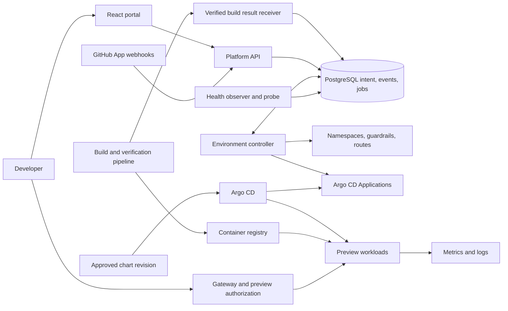

# KubeSpawn: ephemeral environment platform

**Architecture specification v3.0 — proposed design**  
**Revision date:** 25 October 2026  
**Baseline:** `kubespawn_idp_architecture_specification.md`, version 2.0

This revision defines component ownership, lifecycle behavior, security boundaries, and acceptance criteria. It is an architecture contract, not an implemented or production-certified platform. Numeric limits are initial operating assumptions to validate with the target application.

## 1. Purpose and scope

KubeSpawn gives developers an isolated preview of an approved application revision, with a predictable lifetime and a clear readiness signal. Opening an eligible pull request or submitting an authorized manual request creates an environment. Updating the PR deploys a new verified revision into that environment. Closing the PR, reaching its expiry, or requesting deletion removes it.

The first release supports one organization, one workload cluster, one approved application template, and trusted internal contributors. It serves multiple repositories using stable repository identities. Arbitrary Helm charts, arbitrary Kubernetes manifests, production data, public anonymous previews, and untrusted fork execution are outside the first release.

The platform must demonstrate these invariants:

1. Reconciliation never makes a new provisioning decision for `ABSENT` intent; any previously issued in-flight effects are discovered and removed by teardown.
2. Every deployed image is identified by an immutable digest linked to its source revision and successful build verification.
3. The platform reports a revision as ready only after observing that revision's deployment, migrations, route, and application health.
4. Deletion completes only after managed resources and billable dependencies are verified absent.
5. Every read, mutation, log stream, and preview request is authorized for its environment.
6. A crashed process, duplicate webhook, or retried job cannot bypass quota or reverse deletion.

## 2. Architecture decisions

| Decision | Choice | Reason |
|---|---|---|
| Lifecycle authority | PostgreSQL environment records | A durable place to resolve PR, manual, TTL, and policy decisions |
| Workload reconciler | Argo CD Applications managed by the KubeSpawn controller | Declarative deployment without a second PR-driven lifecycle owner |
| Deployment templates | Reviewed Helm chart in Git, pinned to a full revision | Repeatable rendering and controlled changes |
| Work queue | PostgreSQL jobs with leases and an outbox | Durable retries without requiring Redis or a message broker initially |
| Edge | Gateway API with Envoy Gateway | Maintained routing implementation with explicit ownership of TLS and access controls |
| Network enforcement | Cilium with tested policy enforcement | Consistent local and production isolation; optional DNS-based egress policy |
| Identity | Organization OIDC plus repository/team authorization | Clear human identity and environment permissions |
| PR integration | GitHub App | Installation-scoped access and short-lived credentials |
| Database per preview | PostgreSQL container with synthetic seed data | Fast disposable application state without production access |
| Secrets | Per-environment credentials; ESO/Vault integration when required | A defined scope and revocation lifecycle |
| Cost reporting | Estimated allocation plus separately measured infrastructure cost | Honest accounting without treating requests as cloud invoices |

**GitOps boundary:** workload templates and platform configuration live in Git. Runtime environment intent lives in PostgreSQL; the controller writes the corresponding Argo CD Application. This is declarative workload delivery using Git-backed templates, not a claim that every lifecycle action is stored as a Git commit.

Do not install a PR ApplicationSet for these same environments. Git-managed bootstrap Applications must not also manage runtime-generated Application objects. A future requirement for Git-authoritative environment intent needs a separate architecture decision and a migration of ownership.

## 3. Components and trust boundaries



The API and controller can share a Java codebase but run as separate Deployments and identities. The public API has no Kubernetes mutation credentials. The controller is an administrative trust boundary: it can create namespaces and grant namespaced deployment access, so its identity, inputs, and network access require stricter protection than application workloads.

Recommended namespaces:

- `kubespawn-system`: API, controller, observers, and notification workers.
- `kubespawn-data`: platform PostgreSQL; production may use a managed database.
- `argocd`: Argo CD and generated Applications.
- `gateway-system`: shared Gateway, authorization integration, and wildcard TLS Secret.
- `observability`: metrics and log services.
- `ks-<repo-key>-pr<pr>-<generation>`: one preview generation.

Production previews run in a workload cluster/account separated from production applications and data. The initial internal release may place platform components in that preview cluster with namespace isolation; a dedicated management cluster is an optional stronger boundary. Namespace isolation is not represented as a sandbox for hostile code.

## 4. Resource ownership

| Resource | Sole desired-state writer | Other component access |
|---|---|---|
| Environment intent, TTL, desired revision | API/event handlers through DB transactions | Controller reads and updates observed fields |
| Namespace and identifying labels | Environment controller | Argo can use the namespace, not manage it |
| Quotas, LimitRanges, network policies, workload service accounts | Environment controller | Workload delivery cannot modify guardrails |
| Per-environment AppProject and Argo deployment RoleBinding | Environment controller | Argo enforces and uses them |
| Per-environment Application | Environment controller | Argo updates status and reconciles workloads |
| Deployments, StatefulSets, Services, ConfigMaps, PVCs, migration Jobs | Argo CD | Observer reads; API users cannot patch them directly |
| HTTPRoute and preview access policy | Environment controller | Gateway reconciles routing and access |
| Gateway and wildcard certificate configuration | Platform infrastructure Git/Terraform | Environment controller attaches allowed routes only |
| Secret material | Designated secret controller/provider | Preview pods consume their scoped credentials |
| GitHub deployment/check status and one preview comment | Notification worker | Build job emits build results, not readiness comments |

The preview chart contains no Namespace, ResourceQuota, LimitRange, NetworkPolicy, RBAC, Gateway, HTTPRoute, ExternalSecret, or Argo resource. Admission policy protects these boundaries even if a configuration mistake weakens Argo project restrictions.

Namespace expiry annotations are informational mirrors of database intent. Editing an annotation does not change the platform TTL.

## 5. Identity and data model

### 5.1 Stable identities

Use GitHub installation ID and numeric repository ID for authorization and identity; repository names and owners can change. PR number is unique only within its repository. Manual environments have a separate request identity and do not require a fake PR number.

Each environment has a UUID and a generation-specific namespace. An example is `ks-r7fc9-pr42-g2b61`. The namespace encoder must produce a valid DNS label of at most 63 characters, detect collisions, and never reuse a namespace for another environment record. Store the full repository name in annotations, not in an unsanitized label value.

Production hostnames use the same generated identifier beneath `preview.example-preview.net`. The portal and API use a separate registrable domain, such as `platform.example.com`, to reduce browser trust shared with application-controlled previews. Example domains are placeholders.

### 5.2 Core records

| Record | Required data |
|---|---|
| `environment_sources` | Tenant, project, installation/repository IDs, source kind (`PR` or `MANUAL`), PR number or manual request ID, latest verified source state and head SHA, suppression reason, active environment ID |
| `environments` | UUID, source ID, cluster ID, namespace, desired state, observed phase, intent version, requested revision, deployed revision, chart revision, expiry, creation and verified destruction timestamps |
| `environment_conditions` | Environment, condition type/status, reason, message, observed intent version, transition time |
| `builds` | Repository, full source SHA, workflow/run identity, result, image digests per component, verification evidence, timestamps |
| `webhook_deliveries` | Installation and delivery ID, payload hash, receipt time, processing state; unique delivery constraint |
| `jobs` | Type, target ID, intent version, deduplication key, available time, lease owner/token/expiry, attempts, last error |
| `outbox_events` | Event ID, aggregate ID/version, payload, publication state; inserted with the associated state change |
| `audit_events` | Actor, action, environment/source references, request ID, old/new intent versions, reason, timestamp |
| `capacity_reservations` | Tenant/project/cluster, environment ID, reserved resources and slots, release state |
| `usage_intervals` | Environment, resource requests, interval start/end, price-catalog version, estimate classification |

Use `timestamptz` and database UTC time for lifecycle comparisons. Set `updated_at` explicitly or with a database trigger; a default value alone does not maintain it.

Database constraints enforce source-kind fields, nonnegative resource quantities, valid states, unique `(cluster_id, namespace)`, and at most one live generation per source. A partial unique index can use `destroyed_at IS NULL`; terminating and cleanup-blocked environments still occupy that slot. Keep destroyed history and create a new UUID/namespace for a later generation.

Audit retention is independent of environment-row retention. Do not cascade-delete audit evidence when removing historical environment metadata. Raw webhook and log retention must avoid unnecessary credentials and personal data.

## 6. Lifecycle and concurrency contract

### 6.1 Desired state and observed phase

Desired state is `ACTIVE` or `ABSENT`. Observed phase is one of:

`WAITING_BUILD`, `QUEUED`, `PROVISIONING`, `READY`, `UPDATING`, `DEGRADED`, `FAILED`, `TERMINATING`, `CLEANUP_BLOCKED`, `DESTROYED`.

Conditions give precise reasons such as `BuildVerified`, `CapacityAdmitted`, `BaselineReady`, `MigrationComplete`, `WorkloadsReady`, `RouteAccepted`, `EndpointHealthy`, and `CleanupComplete`. Do not compress all failures into one status string.

Allowed progression includes:

```text
WAITING_BUILD -> QUEUED -> PROVISIONING -> READY
READY -> UPDATING -> READY | DEGRADED
WAITING_BUILD | QUEUED | PROVISIONING -> FAILED
any non-destroyed phase + desired ABSENT -> TERMINATING
TERMINATING -> CLEANUP_BLOCKED -> TERMINATING -> DESTROYED
```

`FAILED` does not mean resources are absent. It remains subject to expiry and explicit deletion. A failed update may continue serving the previous healthy revision; report both the requested and serving revisions.

`ABSENT` is irreversible within an environment generation. A respawn creates a new generation after cleanup completes. A PR update cannot silently reactivate an expired or manually deleted environment.

### 6.2 PR and manual event rules

- Verify webhook HMAC against raw request bytes, validate event/install/repository eligibility, and durably insert the delivery plus processing job before returning success.
- Deduplicate by delivery ID. Processing uses current GitHub PR state, not delivery order, to resolve stale events. Closed PRs cannot be recreated by a delayed synchronize event.
- Evaluate opened, synchronize, reopened, closed, labeled, unlabeled, and relevant draft/readiness changes against the repository's eligibility policy.
- Label removal or PR closure requests absence. TTL/manual deletion also sets source suppression, preventing automatic respawn while the PR remains open.
- Reopening an eligible PR may create a new generation after confirming current source state and completed cleanup. Respawning an expired open PR requires an explicit authorized request to clear suppression.
- A manual request resolves an allowed branch/ref to a full commit SHA. Moving the branch later does not change that environment without an explicit update.
- Missing builds enter `WAITING_BUILD`; manual requests may dispatch an approved build workflow. A build result alone never authorizes a new environment.

GitHub availability affects source verification and new deployments. Existing previews retain their current revision; local TTL deletion continues during a GitHub outage.

### 6.3 Durable execution

Write state changes, audit events, and outbox entries in one PostgreSQL transaction. Claim jobs with short transactions using `FOR UPDATE SKIP LOCKED`, bounded leases, and fencing tokens. Use at-least-once execution with idempotent effects; do not claim exactly-once delivery.

Serialize mutations per environment with a database advisory lock held on a dedicated connection, or an equivalently proven mechanism. Do not hold a database transaction open during Kubernetes, registry, or GitHub requests. All intent-changing API handlers and controller effects participate in that serialization, reread intent after acquiring the lock, and use optimistic versions/Kubernetes resource versions for writes. Stop issuing effects if lock ownership or the DB connection is lost.

PostgreSQL and Kubernetes cannot share an atomic transaction. A request accepted just before deletion intent may finish afterward. The teardown loop must therefore repeatedly discover owned resources and verify absence; it must not rely on one list/delete pass. Every created object carries the immutable environment ID, and an orphan sweep closes this gap.

Use exponential backoff with jitter, bounded attempts for provisioning, and continuing scheduled retries for cleanup. Preserve failed jobs for diagnosis. Periodic reconciliation repairs missing jobs, orphan resources, stale conditions, and expired leases. Redis is optional later and never the authoritative lifecycle store.

### 6.4 TTL and deletion

Initial defaults: 24-hour expiry from request acceptance, expiry scans every 30 seconds, and a maximum total lifetime of 72 hours. Repository policy may use shorter bounds. Waiting and failed requests also expire. Extension requires authorization, an unexpired ACTIVE generation, and a matching intent version; it cannot cancel accepted deletion.

Deletion sequence:

1. Commit `desired_state=ABSENT`, reason, source suppression where applicable, and a teardown job. This prevents further provisioning.
2. Disable/remove public preview routing and access grants. Revoke environment-only external credentials as soon as the associated provider permits safe cleanup.
3. Delete the owned Argo Application with its foreground resource finalizer. Argo removes chart-managed resources; wait for actual completion.
4. Delete controller-owned namespace resources and the namespace. Verify its absence and check separately tracked storage/external dependencies.
5. Verify credential revocation and provider cleanup, remove the per-environment AppProject and deployment binding, close usage intervals, and release capacity reservations.
6. Set `DESTROYED` and `destroyed_at` only after the cleanup inventory is empty. Publish final status through the outbox.

A cleanup timeout sets `CLEANUP_BLOCKED`, retains relevant reservations, and alerts an operator. Never automatically strip arbitrary finalizers. An audited operator runbook may remove the Argo finalizer after independently proving managed resources are gone; otherwise it may leak resources. Known-safe independent cleanup can continue during an Argo outage, but completion still requires all inventory checks.

## 7. Build, artifact verification, and rollout

### 7.1 Build contract

For the initial release, build the full PR **head SHA**. If merge-result previews are introduced later, store that merge SHA as a distinct source identity and display it accurately.

The pipeline must:

1. Check out the explicitly selected full SHA; disable persisted checkout credentials where unnecessary.
2. Test and build each required component using the approved workflow.
3. Scan artifacts against a documented severity policy and record policy exceptions. If unfixed findings are ignored, report that scope rather than claiming zero findings.
4. Publish API and web images, an SBOM, and provenance; capture registry-returned digests.
5. Submit a result that the trusted receiver verifies against repository, run identity, source SHA, workflow trust, registry scope, and successful checks.

Human-readable tags may contain a SHA but are never the deployment authority. A deployment revision records the full SHA, every component digest, chart revision, template configuration hash, and migration contract version. CI has no Kubernetes deployment credentials.

Pin third-party actions to reviewed full commit SHAs and update them through dependency automation. Use minimal job permissions and separate untrusted build execution from privileged publication/notification. Workflows, chart inputs, and attestations controlled solely by PR code are not sufficient evidence of trust. The first release rejects forks; a later fork mode needs approved isolated runners, a restricted registry publication path, and a stronger runtime boundary.

### 7.2 Deployment and readiness

Only a verified complete artifact set can enter `QUEUED`. After admission, the controller establishes the namespace baseline before creating an Application. Baseline failure prevents application deployment.

The Application uses a dedicated AppProject, an exact destination namespace, a full chart Git revision, and digest-based image values. Configure automated sync, pruning, and self-healing. Omit `CreateNamespace=true`: namespace ownership belongs to KubeSpawn. Use the Argo deletion finalizer. Applications are not children of an independent PR ApplicationSet.

For each rollout:

1. Execute an idempotent migration Job tied to that deployment revision.
2. Wait for successful migrations and the expected workload rollout, including observed generation and expected pod image IDs where available.
3. Verify startup/readiness probes and the application's declared dependency checks.
4. Verify HTTPRoute `Accepted` and `ResolvedRefs`, shared Gateway programming, and valid TLS.
5. Probe through the edge with a narrowly scoped identity for the target environment. Confirm expected revision using a trusted deployment observation plus application health response; an arbitrary HTTP 200 is insufficient.
6. Commit readiness only if the observed intent version and requested revision are still current.

The observer publishes a GitHub deployment/check status and updates one stable preview comment. Older build results and notifications must not replace newer desired/ready revisions. API and UI distinguish `requestedRevision`, `servingRevision`, and the last failed rollout.

Initial provisioning has a configurable 10-minute failure deadline. A new revision supersedes stale queued builds. Use build concurrency cancellation where possible, plus server-side revision checks regardless of CI cancellation behavior.

## 8. Networking, TLS, and preview access

### 8.1 Gateway model

Use one shared HTTPS Gateway with a wildcard listener and certificate for `*.preview.example-preview.net`. Cert-manager obtains the production wildcard certificate through DNS-01 using a restricted DNS identity. Its private key stays in the trusted Gateway namespace and is never copied to preview namespaces.

Create a wildcard DNS record targeting the shared Gateway. ExternalDNS is optional for this fixed record; it is not required per environment. Use provider-managed DNS/IaC unless dynamic records are needed.

The controller owns each namespace's HTTPRoute, attaches it to the shared Gateway, and exposes only approved web/API services and ports. `allowedRoutes` restricts attachment to managed namespaces. Admission verifies exact environment-hostname ownership and denies arbitrary cross-namespace backend references. Users and Argo cannot create alternate routes or change access policy.

### 8.2 Private-by-default access

All preview requests pass through organization authentication and environment authorization. Implement this using the chosen Envoy Gateway security extensions plus a trusted authorization service; authentication extensions are implementation-specific, not a portable Gateway API guarantee. A platform-wide gateway policy must not be overridable by preview workloads.

The authorization decision binds the authenticated user/service principal to tenant, repository, and environment ID. Probe identities have access to one environment's health paths only. Automated browser tests receive separate short-lived credentials with explicit scope.

Keep portal sessions separate from preview sessions. Use host-only secure cookies, avoid a parent-domain cookie shared by all previews, and strip platform authentication cookies and bearer credentials before forwarding to application backends. Preserve only application-owned cookies and explicitly approved identity headers. Untrusted application scripts must not receive organization access tokens.

Use a fixed callback on the trusted authentication service and an audience-bound, short-lived one-time exchange to establish preview-host sessions. Callback and exchange paths are routed to that service, never to preview code. Validate state, nonce, PKCE where applicable, and return URLs against the environment registry. Verify this flow with the selected identity provider before declaring preview SSO complete.

### 8.3 Network policy

Start with deny-by-default ingress and egress. Permit only the required application graph: Gateway to web/API on approved ports; API to its own database/cache; DNS to designated cluster resolvers over UDP and TCP 53; and explicitly approved telemetry paths.

External access is disabled by default. Repository templates can request sandbox destinations through reviewed policy. With Cilium DNS-based rules, restrict DNS names and ports, test resolved-IP behavior, and deny sensitive destinations including metadata services, control-plane endpoints, nodes, internal networks, and IPv6 equivalents when enabled. An FQDN allowlist is not an application authorization mechanism; services on shared destination IPs need stronger egress controls when required.

Do not use `0.0.0.0/0:443` as the baseline. NetworkPolicy behavior depends on the actual CNI, address translation, and cloud network; validate the production path as well as KinD. The network suite must prove blocked traffic, not only show policies were accepted.

## 9. Authorization and runtime security

### 9.1 Human and machine authorization

| Role | Permissions |
|---|---|
| Viewer | View authorized environments, readiness, estimates, and permitted logs |
| Developer | Viewer permissions plus create/update/delete owned environments and bounded TTL extension |
| Maintainer | Manage project environments and approve eligible previews |
| Platform administrator | Manage templates, quotas, integrations, and audited cleanup overrides |

Repository/team mappings are checked on each request with bounded caching and revocation handling. A UUID or namespace name is not authorization. Enforce tenant/project predicates in data access. Protect cookie-authenticated mutations from CSRF, validate WebSocket origins, and rate-limit webhook, API, and log endpoints.

Use short-lived GitHub App installation tokens. Authenticate build-result submission through verifiable CI identity and independently checked run metadata. Store integration credentials outside the application database where practical; encrypt secrets and backups according to the deployment's key-management policy.

### 9.2 Kubernetes guardrails

Enforce Restricted Pod Security Admission plus targeted Kyverno rules for requirements not covered by that profile. Require CPU/memory requests and limits, non-root execution, no privilege escalation, dropped capabilities, approved seccomp, and approved image registries/digests. Bound container ephemeral-storage requests/limits and writable `emptyDir` volumes so a preview cannot exhaust node scratch space. Set read-only root filesystems where templates support them and provide explicit writable volumes. Apply each requirement to regular, init, and ephemeral containers where the Kubernetes API supports it; use dedicated debug-container admission restrictions where resource fields are unavailable.

Deny privileged/host namespaces, hostPath, unauthorized service types and external IPs, unapproved runtime classes, arbitrary image pull credentials, and service-account token automount by default. Preview service accounts have no Kubernetes API roles or cloud workload identity. Enforce that pods use the controller-created restricted service account.

Argo receives namespace-scoped deployment permissions only after baseline creation. Use per-environment AppProjects with explicit source repositories, exact destinations, no permitted cluster-scoped resources, and a namespaced resource allowlist. Never target the unrestricted `default` project. Argo configuration and chart repositories are trusted administrative inputs.

Kubernetes RBAC cannot generally constrain namespace creation by a label or name prefix. Protect the controller through admission rules, strict input validation, a dedicated identity, constrained network access, and audit. Its administrative privilege must be acknowledged in the threat model.

Do not allow admission failures to silently bypass mandatory preview policy. Test the order of LimitRange defaulting, mutation, and validation rather than assuming every policy engine observes the same object shape.

## 10. Data, migrations, secrets, and storage

The default template runs disposable PostgreSQL with one per-environment PVC and synthetic seed data. Redis is included only when the target application requires it. This is production-like behavior, not production-equivalent availability or scale.

Define the storage class, supported access mode, size, encryption, expansion policy, and `Delete` reclaim behavior. Track provider volume identifiers and verify deletion; namespace absence alone does not prove cloud storage was removed. Reject or explicitly account for storage classes that retain disks.

Migrations run as versioned Jobs before traffic readiness. Initial-release schema changes are forward-compatible within an environment. A failed deployment may roll back application images only if schema compatibility is known; do not promise automatic database rollback. Resetting seeded preview data is an explicit destructive action, distinct from retrying a rollout.

Generate unique database credentials per environment. Where Vault is used, scope roles and leases to that environment and track revocation. ESO synchronizes approved namespace secrets; platform-controlled SecretStore configuration must not let a chart select another environment's secret path. Do not describe secret synchronization itself as dynamic credential generation or revocation.

Never inject production credentials, customer data, broad cloud keys, or platform tokens. Restrict registry pulls to necessary repositories using scoped pull identity; verify that private-image access works before reporting baseline readiness.

## 11. Capacity, quotas, and cost

### 11.1 Admission control

Initial small-template budget:

| Resource | Namespace ceiling |
|---|---|
| CPU requests / limits | 1 vCPU / 2 vCPU |
| Memory requests / limits | 2 GiB / 4 GiB |
| Storage requests | 5 GiB |
| Pods / Services / PVCs | 10 / 5 / 2 |

These are starting values, not guarantees that every application fits. Templates explicitly budget migration Jobs, rollout surge pods, and sidecars. A rollout must fit the quota at its peak, not just at steady state. PostgreSQL initialization must fit its storage budget. Add template-specific ephemeral-storage ceilings and object-count quotas for Jobs, Secrets, and ConfigMaps; prune completed migration history within a bounded retention policy.

Also cap active and queued environments per user, project, tenant, and cluster. Reserve capacity atomically under tenant/project/cluster allocation locks before provisioning, with namespace quota as the second boundary. Keep cluster headroom for system workloads and configured rollout overlap. Queue requests when capacity is unavailable; expose a reason and position estimate only when defensible. Reject requests that can never fit the selected template.

Reservations remain charged while resources exist, including failed cleanup. Reconcile abandoned reservations against inventory before release. Prioritize cleanup and TTL work over new provisioning during pressure.

### 11.2 Cost model

Compute request-based allocation over time, using versioned provider/region-specific rates:

`estimated allocation = sum((requested vCPU * vCPU-hour rate + requested GiB * GiB-hour rate) * interval hours) + storage allocation`

Close and reopen intervals when resource requests change. Account for setup, migration, rollout overlap, termination, and orphan-resource lifetime. Report shared control-plane, Gateway, telemetry, idle nodes, registry/build, NAT, and egress costs separately when available; avoid double-counting shared costs already included in an allocation rate.

Label request-based totals as estimates. Compare them with actual billing exports separately. Savings require an explicit baseline: for example, one shared staging cluster for a project, or one static environment per team. Do not assume one static environment per developer when the real alternative is shared staging.

Report allocated resource-hours avoided by TTL separately from cash savings. Cash savings depend on node scaling and actual billing changes. CPU and memory efficiency use measured usage divided by requests over a stated window; they are not inferred from quotas.

## 12. API and portal contract

All responses include a request ID. Mutations return an operation ID and current intent version. Asynchronous provisioning/deletion returns `202 Accepted`; it does not claim completion. Use idempotency keys for creates and `If-Match`/version preconditions for competing mutations.

| Method | Endpoint | Contract |
|---|---|---|
| POST | `/api/v1/webhooks/github` | Verify and durably enqueue; no synchronous provisioning |
| POST | `/api/v1/build-results` | Authenticate and verify build evidence before acceptance |
| GET | `/api/v1/environments` | Authorized, filtered, cursor-paginated observed snapshot |
| POST | `/api/v1/environments` | Create a manual request from an allowed repository/ref/template |
| GET | `/api/v1/environments/{id}` | Desired/observed state, conditions, requested/serving revision, observation time |
| PATCH | `/api/v1/environments/{id}/expiry` | Set an allowed absolute expiry with concurrency and lifetime checks |
| POST | `/api/v1/environment-sources/{id}/respawn` | Explicit new generation; verify eligibility and completed cleanup |
| DELETE | `/api/v1/environments/{id}` | Commit absence and return teardown operation; retries are idempotent |
| GET | `/api/v1/operations/{id}` | Progress, retryable failure, completion, and actionable reason |
| GET | `/api/v1/costs/summary` | Time window, estimate scope, baseline, and pricing version |
| WS | `/api/v1/environments/{id}/logs` | Authorized pod/container selection within the environment |

The portal shows capacity wait reasons, build verification, provisioning steps, requested versus serving commit, TTL, last observed health, cleanup progress, and estimate assumptions. Never show a ready badge merely because the build passed or a namespace exists.

Do not make list requests synchronously query Kubernetes for every environment. Observers maintain snapshots using watches plus periodic full reconciliation; expose staleness. Logs use bounded buffers, connection limits, idle timeouts, cancellation, and per-user limits. Reauthorize long-lived streams and close them on revocation or environment deletion. Log access is sensitive; workloads may print credentials and masking is not a complete safeguard.

## 13. Observability and service objectives

Measure separate intervals for webhook acceptance, build completion, capacity wait, baseline setup, sync/migrations, edge readiness, and cleanup. Store per-environment timing in events/traces; keep metric labels bounded by template, cluster, outcome, and reason. Do not use environment UUID, PR number, commit SHA, or namespace as high-cardinality metric labels.

Initial objectives are proposed targets to validate:

- Webhook durable acceptance: p95 under 2 seconds while dependencies are healthy.
- Preview creation: p95 under 90 seconds **from verified artifacts and capacity admission**, for the measured small template on ready nodes with wildcard TLS/DNS already provisioned.
- End-to-end PR-to-ready: measured separately, including build time and capacity wait; no fixed 90-second promise.
- Expiry detection: p99 within 60 seconds of expiry while the control plane is available.
- Cleanup: p95 under 5 minutes after deletion intent under healthy cluster/provider conditions; blocked cleanup alerts at 10 minutes.
- Platform API availability: initial target 99.5% monthly, excluding explicitly defined local-demo operation; establish the measurement and budget before raising it.

Export active/queued/cleanup-blocked gauges; build/provisioning/cleanup duration histograms; webhook/job retry counters; controller last-success time; DB/outbox queue age; usage allocation estimates; and policy-denial counts. Alert on stalled reconciliation, old jobs, unverified readiness, resource leaks, certificate expiry, quota pressure, and missing policy enforcement.

Use structured logs with request/environment/revision IDs and trace correlation. Restrict actuator endpoints and redact credentials. Set explicit retention and storage ceilings for logs, events, traces, and metrics so observability itself does not grow without limit.

## 14. Failure behavior and recovery

| Failure | Required behavior |
|---|---|
| Duplicate/out-of-order webhook | Deduplicate delivery; verify current source; preserve monotonic deletion |
| Registry unavailable or artifact missing | Block deployment, retry, and retain accurate build conditions |
| Argo unavailable | Preserve intent, queue work, close routing for deletion where possible, alert on stalled cleanup |
| Kubernetes unavailable | Retain reservations and unconfirmed cleanup; retry without false destruction |
| DB unavailable | Reject new mutations, stop unsafe controller effects, preserve current workload revision |
| Worker crash/expired lease | Another worker reclaims work; idempotent effects reconcile partial progress |
| Controller created resource before DB acknowledgement | Discover immutable environment ownership labels and reconcile inventory |
| PR update arrives during deletion | Do not resurrect; require a new authorized generation |
| Migration fails | Fail the new revision; report whether the prior revision remains available |
| Volume/credential cleanup fails | Keep `CLEANUP_BLOCKED`, maintain inventory and relevant accounting, alert |
| Policy engine unavailable | Mandatory admission fails closed; portal exposes the blocked reason |
| Identity provider unavailable | Preview authorization fails closed for new/invalid sessions; documented bounded handling for existing sessions |

Production PostgreSQL needs backups, point-in-time recovery, and a tested restore procedure. Initial operational targets: recovery-point objective 15 minutes and recovery-time objective 4 hours, to be validated. After restoring the intent database, quarantine normal provisioning and compare it with cluster inventory, restored versions, source suppression, and provider resources before resuming. Export deletion tombstones/audit evidence to a durable store outside the database recovery boundary. A restored ACTIVE record with missing resources remains quarantined unless current intent is corroborated by that evidence; an open PR alone is insufficient. If evidence is ambiguous, require an explicit authorized respawn into a new generation rather than recreating the restored generation. A restored old ACTIVE record must not blindly recreate a previously deleted environment.

Maintain runbooks for stuck finalizers, orphan volumes, expired credentials, unavailable identity/DNS providers, cluster loss, and emergency preview shutdown. Pin workloads and platform components to tested versions with a compatibility matrix and scheduled upgrades. Choose supported Spring Boot patches compatible with Java 21, and supported versions of Kubernetes, PostgreSQL, Argo CD, Gateway API/Envoy, Cilium, and policy tools at implementation time; the old example versions are not a deployment baseline.

## 15. Repository layout

```text
kubespawn-platform/
  docs/
    architecture.md
    decisions/                  # Ownership, trust model, cost model, recovery ADRs
    runbooks/
    threat-model.md
  infra/
    local/                      # KinD, Cilium, local Gateway, CA/bootstrap scripts
    terraform/                  # Cluster/network/DNS/IAM/state configuration
    platform/                   # Argo, Gateway, cert-manager, policy, observability
  templates/
    preview-small/              # Trusted workload-only Helm chart and schema
    baseline/                   # Controller-managed quotas, policies, route templates
  control-plane/
    api/                        # OIDC, RBAC, requests, webhooks
    controller/                 # Jobs, reconciliation, teardown, inventory
    integrations/               # GitHub App, registry verification, secrets
    observer/                   # Argo/Kubernetes/edge health and usage intervals
    persistence/                # Schema, migrations, outbox, reservations
  portal/
  workflows/                    # Reviewed reusable build contracts
  tests/
    integration/
    lifecycle/
    security/
    recovery/
    performance/
```

Infrastructure bootstrap and application deployment have separate permissions and workflows. Local and production profiles share lifecycle behavior and policy contracts; profiles differ in provider integration, sizing, certificates, and availability.

## 16. Local demonstration profile

Run KinD with Cilium explicitly installed as the enforcing CNI and a tested local Envoy Gateway exposure method. Port mappings alone do not install or schedule a Gateway. Use a local registry or an authenticated external registry and verify node pull access. Document Docker/WSL requirements, available CPU/RAM/storage, and a measured minimum for the selected profile.

Use `*.127.0.0.1.nip.io` only for local name resolution if the local resolver permits it. Use a locally trusted development CA for TLS and document the trust installation; do not imply public ACME will validate a loopback-only deployment. Use separate local portal and preview hostnames with host-only authentication cookies; production still uses separate registrable domains.

A GitHub webhook cannot reach loopback directly. For a connected demo, use an explicitly configured authenticated development tunnel with HMAC validation at the receiver, or a local event simulator/poller. A local build runner may publish/load images and submit verified development results through an explicit development-only trust profile; never enable that bypass in production.

The minimal profile includes the API/controller, PostgreSQL, Argo CD, Gateway, cert-manager or preinstalled local certificates, Cilium, and one sample app/database. Enable full telemetry, Vault/ESO, and cloud integrations incrementally. This avoids cloud hosting spend; it does not claim hardware, electricity, registry, tunnel, or CI resources are universally free.

## 17. Acceptance and validation gates

Use unit tests for lifecycle decisions, integration tests for transactions/concurrency, and real-cluster tests for Kubernetes/network behavior. Fabric8 mocks are useful for client behavior but cannot validate admission, finalizers, storage, or CNI isolation.

The release must demonstrate:

1. Duplicate and reversed webhook delivery creates at most one live generation.
2. PR closure wins over delayed open/update events after current-source verification.
3. TTL deletion cannot be undone by Argo self-healing, controller restart, or PR synchronization.
4. TTL extension and deletion races have one observable, versioned outcome.
5. Two workers cannot bypass capacity reservations or commit stale readiness.
6. Controller termination at each provisioning/deletion stage is recoverable without orphaning resources.
7. The deployed digest matches verified build evidence and the UI's serving revision.
8. A stale successful build cannot deploy over a newer requested revision.
9. Failed migrations and unavailable endpoints never publish ready status.
10. Preview A cannot reach preview B's database, platform PostgreSQL, Kubernetes API, metadata service, or unapproved internet destinations.
11. Approved DNS works over UDP and TCP, and permitted application dependencies remain reachable.
12. A viewer/other tenant cannot delete, extend, inspect logs, or access unauthorized previews, including over an existing WebSocket.
13. App charts cannot change guardrails, attach arbitrary routes, acquire elevated service accounts, or create cluster-scoped resources.
14. Namespace deletion with a stuck finalizer remains unconfirmed; storage and credential leaks produce blocked cleanup.
15. Restoring an older DB snapshot does not automatically resurrect deleted environments.
16. Measured provisioning and cleanup distributions include cold image pulls, storage delays, and concurrency scenarios, with exclusions disclosed.

Run a dependency vulnerability check, rendered Helm/schema validation, policy tests, and end-to-end smoke tests against the pinned compatibility matrix. Publish measured results and known limitations with the release.

## 18. Delivery plan and scope gates

### Gate A: lifecycle vertical slice

One trusted repository, local cluster, verified image digests, PostgreSQL intent/jobs, controller-managed Applications, baseline-before-workload ordering, readiness observation, TTL, and confirmed cleanup. Test restart recovery and the self-healing/expiry interaction before building a full portal.

### Gate B: usable internal preview service

OIDC/repository RBAC, private preview access, a small portal, manual requests, bounded TTL extensions, quotas/reservations, audit events, and stable GitHub status updates. Validate authorization and network-denial tests.

### Gate C: operational pilot

Shared wildcard TLS/DNS, production storage/secret integration, backup/restore, alerts, usage estimates, concurrency/load measurements, and runbooks. Pilot with a small team and publish actual timing/cost evidence.

### Gate D: broader service

Only after pilot evidence: additional templates/clusters, stronger tenant isolation, billing reconciliation, optional dynamic secrets, and separately designed untrusted-fork support. Multi-cluster scheduling is outside the initial release even though identity records reserve a cluster field.

A six-week individual effort should target Gates A and B with a constrained demonstration of C. Production readiness is determined by validated gates and operating evidence, not the calendar or number of tools installed.

## 19. Changes from version 2

- Replaced competing PR ApplicationSet/reaper ownership with a durable intent controller and managed Argo Applications.
- Made absence monotonic, added source suppression, and separated termination from verified destruction.
- Replaced short-SHA tags with verified component digests and pinned template revisions.
- Moved readiness reporting from CI publication to observed deployment and edge health.
- Replaced community ingress-nginx with Gateway API/Envoy Gateway and centralized wildcard TLS.
- Added explicit preview authorization, browser credential boundaries, enforcing CNI requirements, and a constrained contributor trust model.
- Added generation identities, manual-source support, durable jobs/outbox, concurrency rules, capacity admission, and recovery behavior.
- Reframed cost/speed claims around stated assumptions and measurable evidence.
- Reduced initial infrastructure requirements and made enterprise extensions explicit.

## 20. Primary references

These sources support component capabilities and limitations; all designs still require testing against pinned release versions.

- [Argo CD automated sync and self-healing](https://argo-cd.readthedocs.io/en/stable/user-guide/auto_sync/)
- [Argo CD Application deletion and finalizers](https://argo-cd.readthedocs.io/en/stable/user-guide/app_deletion/)
- [Argo CD Projects and deployment restrictions](https://argo-cd.readthedocs.io/en/stable/user-guide/projects/)
- [Argo CD PR generator lifecycle and SHA parameters](https://argo-cd.readthedocs.io/en/stable/operator-manual/applicationset/Generators-Pull-Request/)
- [GitHub workflow events and PR merge/head behavior](https://docs.github.com/en/actions/reference/workflows-and-actions/events-that-trigger-workflows)
- [GitHub security guidance for privileged PR workflows](https://docs.github.com/en/actions/reference/security/securely-using-pull_request_target)
- [Kubernetes finalizers](https://kubernetes.io/docs/concepts/overview/working-with-objects/finalizers/)
- [Kubernetes multi-tenancy](https://kubernetes.io/docs/concepts/security/multi-tenancy/)
- [Kubernetes NetworkPolicy API and enforcement requirements](https://kubernetes.io/docs/reference/kubernetes-api/networking/network-policy-v1/)
- [Kubernetes ingress-nginx retirement announcement](https://kubernetes.io/blog/2025/11/11/ingress-nginx-retirement/)
- [Cert-manager wildcard certificates and namespace sharing](https://cert-manager.io/docs/devops-tips/syncing-secrets-across-namespaces/)
- [Envoy Gateway SecurityPolicy](https://gateway.envoyproxy.io/docs/concepts/gateway_api_extensions/security-policy/)
- [Cilium DNS-based egress policy](https://docs.cilium.io/en/stable/security/dns/)
- [KinD configuration](https://kind.sigs.k8s.io/docs/user/configuration/)
